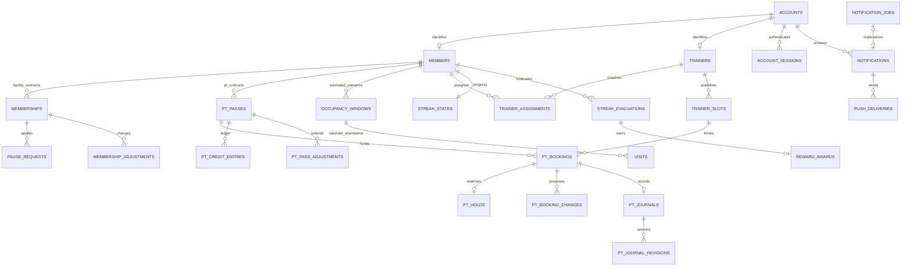

# 헬스장 앱 DB 설계서

버전: 1.1 · 작성일: 2026-10-19 · 기준: `요구사항정의서.md` v1.1

대상 DB: PostgreSQL 15 이상. 단일 헬스장, Android·iOS·웹 공통 서버 DB다. 요구사항의 사용자 확정 정책과 위임된 기본안을 모두 현재 설계 기준으로 반영한다. 실제 운영자가 입력할 운영시간·혼잡도 기준 인원·휴회 한도는 임의로 채우지 않는다.

실행 파일은 `db/001_schema.sql`, 개발 DB 검증용 파일은 `db/002_smoke_test.sql`이다. 이전 설계와 SQL은 `db/archive/v0.1/`에 보관한다. 새 SQL은 신규 DB용 기준이며 기존 DB를 자동 변환하지 않는다.

## 1. 이전 설계에서 바뀐 점

| 영역 | v1.0 반영 |
|---|---|
| 출석·혼잡도 | 방문 날짜 기록과 2시간 혼잡도 구간을 별도 테이블로 분리. 자정 후 새 출석이 기존 구간을 연장하지 않음 |
| 개근 | 휴회 시 초기화 폐기. 휴회·휴무·월 변경은 유지. 결석·시설 만료에 의한 구간 종료만 초기화 |
| 보상 | 10일 즉시 자동 1일. 마지막 유효일도 지급. 재판정은 별도 검토이며 사용 보상 자동 회수·청구 없음 |
| 회원권 | 만료일 포함, 시설 기간 겹침 금지, 갱신 계약 연결과 연장에 따른 후속 기간 이동 |
| 휴회 | 한도 버전·신청 당시 스냅샷, 승인 기간·실제 기간 분리, 시설·PT 기간 조정, 조기 복귀 |
| PT | 계약별 이용권·유효기간·잔액·확보. 예약 즉시 확정, 수업 종료 후 차감, 늦은 취소 확보 유지 |
| PT 변경 | 회원 동의 제안과 확정 예약 분리. 변경 실패 시 원래 예약·확보 유지 |
| 일지 | 예약당 1건, 작성자 보존, 암호화 본문·수정 이력·접근 제한·민감 원문 파기 |
| 계정 | 휴대전화·비밀번호, 활성화/재설정 코드, MFA·복구 코드, 세션·실패 제한 |
| 알림 | 알림함과 푸시 전송 분리. 종류별 설정, 이용권별 만료, 예약·보상·휴회·동의 알림 |
| 보관·탈퇴 | 업무 원장 보호와 적법한 파기 권한 분리. 접속·권한 이력·분리보존·삭제 대장 |

## 2. 공통 규칙

- PK는 `bigint GENERATED ALWAYS AS IDENTITY`를 기본으로 한다. 업무 코드·설정 단일 행·연결 테이블은 예외다. 앱은 순차 ID를 안다는 이유만으로 접근을 허용하지 않는다.
- 시점은 `timestamptz`, 달력 날짜는 `date`다. 출석일·휴회일·만료일·예약 가능 월은 항상 `Asia/Seoul`로 계산한다.
- 시설·PT·휴회 종료일은 포함한다. SQL 구간은 `[시작일, 종료일+1)`로 변환한다. 수업·혼잡도 시각 구간은 `[시작, 종료)`다.
- 남은 일수는 현재 날짜와 만료일로 계산한다. 현재 인원은 유효 구간으로 계산한다. 잔여일을 매일 감소시키거나 현재 인원 증감 카운터만 운영하지 않는다.
- 중요한 쓰기는 회원→트레이너(여러 명이면 ID 순)→이용권(ID 순) 순서로 잠근다. 관련 경로에서 같은 순서를 지켜 교착 가능성을 줄인다.
- 시간·권한·자격은 서버가 확인한다. DB의 FK와 CHECK만으로 운영 권한과 모든 시점 규칙이 보장되지는 않는다.
- 이름·전화번호·일지·알림 본문·푸시 토큰은 암호화 또는 해시 필드로 분리한다. 비밀 원문은 로그에 저장하지 않는다. 키 참조는 DB에, 실제 키는 외부 KMS에 둔다.
- 현황 행의 `version`은 서비스에서 원자적으로 증가시킨다. 모든 테이블의 수정 시각·버전을 자동 변경하는 공통 트리거는 두지 않았다.

## 3. 주요 ERD

ERD는 주요 업무 관계다. 상세 FK·NULL·UNIQUE·CHECK는 SQL을 기준으로 한다.

## 4. 테이블 사전

### 4.1 계정·인증

| 테이블 | 주요 데이터와 용도 |
|---|---|
| `accounts` | 전화번호 검색 HMAC·암호화 번호/이름, KMS 키 참조, 비밀번호 전용 해시, 상태, security_version, 운영자 등록자, 만 14세 이상 확인 사실 |
| `account_roles` | 회원·트레이너·운영자 역할과 부여자. 복합 PK(account_id, role) |
| `members` | 계정 연결, 등록/승인/정지/탈퇴, 승인자·시점, 첫 이용일 |
| `trainers` | 트레이너 계정과 재직/정지/퇴사 상태 |
| `auth_codes` | 활성화/비밀번호 재설정 코드 해시, 발급자, 24시간/15분 만료, 사용·폐기·실패 횟수 |
| `mfa_enrollments` | 인증 앱 비밀 암호문, 확인·폐기, 마지막 사용 시간 단계 |
| `mfa_recovery_codes` | 인증 연결별 1~10번 복구 코드 해시와 사용 시각 |
| `account_sessions` | 토큰 해시, 계정 security_version, 생성·활동·절대 만료·재인증·MFA·회수 시각 |
| `login_attempts` | 계정/번호/요청 출처의 해시 지문과 성공 여부, 시각·파기 기한 |

번호 HMAC는 정규화된 번호에 DB 밖 비밀키를 적용한다. 단순 번호 해시는 추측 공격에 취약하므로 사용하지 않는다. 비밀번호 12~128자 확인과 적절한 비밀번호 해시는 서버에서 처리한다.

새 코드 발급은 기존 미사용 코드를 먼저 폐기하고 추가한다. 만료된 행도 부분 UNIQUE에 남으므로 폐기 처리 없이 새 발급하지 않는다. 동일 코드 사용·실패 횟수 증가는 코드 행 잠금으로 원자 처리한다. 성공·5회 실패·만료 시 인증용 해시는 목적 종료에 맞춰 제거하고 비밀값 없는 보안 사건만 보존한다.

운영자 세션은 MFA 완료 후 발급한다. 일반 7일/운영자 30분 비활동 제한은 last_seen_at과 비교하고, 절대 만료 30일/12시간은 SQL로 제한한다. 정지·퇴사·복구는 security_version 증가와 세션·QR·푸시 등 회수를 한 트랜잭션/아웃박스로 연결한다. 실제 관리자 복구·초기 운영자 생성은 배포 담당자의 별도 절차로 수행한다.

### 4.2 설정·운영 달력

| 테이블 | 주요 데이터와 용도 |
|---|---|
| `policy_versions` | 정의서 버전, 적용 구간, 정책 스냅샷·변경자·사유. 적용 구간 겹침 금지 |
| `gym_settings` | 단일 헬스장, KST 고정, 보통/혼잡 시작 인원, 60초 갱신·180초 지연 |
| `weekly_opening_hours` | ISO 요일 1~7별 적용 기간, 휴무 여부, 시작/종료 시각, 익일 종료 offset |
| `calendar_overrides` | KST 날짜별 CLOSED/CUSTOM_OPEN, 사유·revision |
| `calendar_open_intervals` | CUSTOM_OPEN 날짜의 구체적인 영업 시각 구간 |
| `pause_policy_versions` | 최소/최대 일수·계약별 최대 횟수와 적용 구간 |

00:00~다음 날 00:00은 24시간 운영이다. 전날 시작한 익일 영업과 당일 시작 영업의 합집합을 조회하되 해당 KST 날짜의 CLOSED가 최우선이다. CUSTOM_OPEN은 해당 날짜의 일반 규칙을 대체한다. 설정되지 않은 요일이나 휴회 한도를 임의 휴무/무제한으로 해석하지 않는다. 날짜별 개근 평가에도 같은 달력 해석을 사용한다.

휴무 판정과 영업 시각 판정은 다르다. 23:30 방문과 다음 날 00:05 방문은 서로 다른 출석일이며 영업일 시작 시각으로 날짜를 묶지 않는다.

### 4.3 시설 회원권·PT 이용권·휴회

| 테이블 | 주요 데이터와 용도 |
|---|---|
| `memberships` | 시설 계약별 원래 시작/만료일, 조정된 시작/만료일, 전 계약 연결, 등록자·정책·version |
| `pt_passes` | PT 계약별 시작/원래 만료/현재 만료일, 실제 잔액·확보 수·version. 시설과 독립 |
| `pause_requests` | 시설 계약·회원, 신청 당시 한도 버전/스냅샷, 요청/승인/실제 기간, 상태·처리자·이유 |
| `membership_adjustments` | 시설 기간 변경 전후, 보상/휴회/조기 복귀/후속 갱신 이동/수동/역조정, 근거 FK·멱등 키 |
| `pt_pass_adjustments` | PT 만료일 변경 전후, 휴회/조기 복귀/수동/역조정, 근거 FK·멱등 키 |

시설 기간은 만료일 포함으로 서로 겹칠 수 없다. 연속 갱신은 previous_membership_id로 연결한다. 유효성은 시작일≤KST 오늘≤만료일, 계약 미취소, 회원 이용 상태, 승인 휴회를 종합해 계산한다. 만료일에는 1일이 남으며 화면 문구는 ‘오늘 만료’다. 미래 시작과 휴회 중 표시는 별개다.

현재 계약을 보상/휴회로 늘릴 때 이미 등록된 다음 계약과 겹칠 수 있다. 서비스는 회원 전체 계약을 잠그고 `SET CONSTRAINTS memberships_no_overlap DEFERRED` 후 현재 계약 연장과 연속 갱신 체인 이동을 함께 수행한다. 뒤 계약의 시작·만료일을 같은 일수만큼 이동해 계약 일수를 보존하고 RENEWAL_SHIFT 원장을 각각 남긴다. 비연속 계약과 충돌하면 임의 이동 없이 운영자 검토로 처리한다. 이는 정의서의 중복 금지·연속 갱신을 만족하기 위한 DB 설계 선택이다.

휴회는 신청 시점 한도 스냅샷을 고정한다. 회원은 시작일 전 신청하고 소급·조기 복귀·승인 취소는 운영자가 처리한다. 승인 시 actual 기간을 승인 기간으로 초기화하고, 조기 복귀 시 actual 종료일만 조정해 승인 원본을 보존한다. 날짜는 양끝 포함이며 같은 회원의 승인/실행/완료 휴회는 겹치지 않는다. 취소 건은 구간 제약에서 제외한다.

휴회 승인/변경마다 실제 적용 일수와 이전 적용 일수 차이만 시설·해당 PT 만료일에 원장으로 반영한다. 이미 만료된 PT를 살리지 않는다. 승인 휴회와 겹치는 향후 수업은 PAUSE 취소·확보 해제·알림을 함께 처리한다. 소급 기간의 이미 차감한 수업은 자동 삭제하지 않고 예외 검토로 연결한다. 승인 취소로 취소된 PT를 자동 복구하지 않는다. 휴회 한도 횟수의 승인 취소 후 재계산은 취소 이력을 보존한 유효 승인 건으로 처리한다.

### 4.4 출석·혼잡도

| 테이블 | 주요 데이터와 용도 |
|---|---|
| `checkin_devices` | 등록 기기 인증 해시, 상태·등록자·해제·통신 시각 |
| `member_qr_credentials` | 회원·발급 세션·QR 해시·60초 만료·사용·폐기. 원문 미저장 |
| `occupancy_windows` | 회원별 최초 입장~2시간의 추정 구간, VALID/VOID. 유효 구간 중복 금지 |
| `visits` | 구간과 연결된 날짜 방문, 입장 시각, KST 출석일, 시설/PT 전용/예외, 개근 인정 여부와 근거 |
| `checkin_requests` | 기기별 요청 키·내용 지문·QR·처리 결과·연결 방문. 재시도 결과 복구 |
| `visit_revisions` | 정정 전후·처리자·사유 |

처리 순서는 기기 인증 → 동일 요청 결과 확인 → QR 행/회원 잠금 → 세션·계정·QR 유효성 → 영업시간·휴회·시설/PT 자격 → 구간/방문 기록 → QR 사용 처리 → 즉시 개근/보상 → 커밋이다. 중복 키와 행 잠금을 함께 사용한다.

같은 QR로 새로운 요청을 하면 성공 사용 QR이므로 거절한다. 같은 기기의 동일 요청 재전송은 기존 결과를 반환하며 QR을 새로 소비하지 않는다. 다른 내용으로 같은 요청 키를 보내면 거절한다. 30초마다 새 QR 발급, 각각 60초 유효이므로 동시에 유효한 두 QR이 있을 수 있다.

활성 혼잡도 구간이 있으면 원래 ends_at을 유지한다. 해당 구간·KST 날짜 방문이 없으면 방문을 새로 만들고, 이미 있으면 그 방문으로 중복 성공 처리한다. 구간이 끝났으면 새 구간·방문을 만든다. 예: 23:30 입장→익일 01:30 종료. 00:05 재스캔은 두 번째 출석일만 추가하고 종료는 01:30 유지다. 01:30 재스캔부터 새 구간이 가능하다.

PT 전용 출석은 당일 유효 확정 예약의 시작 30분 전≤현재<종료 시각인 경우다. 휴회 중에는 허용하지 않는다. FACILITY와 PT_ONLY를 구분하고 PT_ONLY는 reward_eligible=false로 강제한다. 수동 예외도 시설 개근 근거가 있어야 보상 인정할 수 있다. 미래 출석은 트리거에서 거부한다.

월별 출석은 `member_attendance_days`에서 날짜를 고유 집계한다. 혼잡도는 `current_congestion`으로 계산하고 조회 성공 시각을 반환한다. 보통/혼잡 기준이 NULL이면 표시 미설정, 성공 갱신 후 180초 이상이면 정보 지연, 조회 실패이면 오류로 표시한다. 이 상태·갱신 타이머는 서버/클라이언트 책임이다.

### 4.5 담당자·예약·확보·차감

| 테이블 | 주요 데이터와 용도 |
|---|---|
| `trainer_assignments` | 회원 담당자 적용 구간·변경자·사유. 회원별 구간 겹침 금지 |
| `trainer_slots` | 트레이너의 공개/철회한 1시간 슬롯, 시작 30분 단위 |
| `pt_bookings` | 예약 당시 담당·슬롯·고정 PT 이용권, 수업 시각·종료 후 차감 기준 시각, 취소 종류·수업 결과·version |
| `pt_booking_changes` | 변경 제안, 기존 예약 version/구간, 새 슬롯/배정, 사유·회원 승인·적용 시각. 제안은 시간을 점유하지 않음 |
| `pt_booking_events` | 예약·변경·취소·이전 등 전후값·처리자·멱등 키 |
| `pt_holds` | 예약당 한 건, 확보 이용권, HELD/RELEASED/CONSUMED |
| `pt_credit_entries` | 부여·차감·복원·일반 조정과 잔액 전후, 원장 역참조·멱등 키 |
| `pt_charge_exceptions` | 운영자 전용 면제/복원 근거. 일반 횟수 조정과 별도 |

예약 가능 범위는 KST 현재보다 미래이고 다음 달 마지막 날짜까지다. 수업 시작일에 유효하며 수업 종료 시점도 이용권 종료일 다음 날 00:00 이하여야 한다. 대상 중 `current_expires_on, id` 순으로 잔액-확보≥1인 PT 이용권을 잠근 후 선택한다. 회원 잠금 아래 처리해 먼저 만료되는 이용권 선택과 동시 요청을 일관되게 한다. 확보 후 이용권은 자동 교체하지 않는다.

회원 직접 예약과 담당 트레이너 대리 예약은 동일한 트랜잭션을 사용한다. 서버는 실제 로그인 계정 기준으로 회원 본인 또는 현재 담당 트레이너임을 확인하고, 트레이너는 본인 공개 슬롯에만 등록한다. `pt_booking_events.actor_account_id`와 이벤트 전후값에 실제 등록자·역할·회원과의 협의 사실을 기록한다. 기존 이벤트 구조를 활용하므로 SQL 테이블 변경은 필요하지 않다. 확정 즉시 관련 회원·트레이너에게 알린다.

예약은 즉시 CONFIRMED다. 담당자·게시 슬롯·회원·트레이너 상태·휴회·유효기간을 확인하고 예약과 확보, 이용권 held_count 증가를 함께 커밋한다. 서로 다른 시작 시각도 실제 구간이 겹치면 회원/트레이너 양쪽 배제 제약으로 막는다. 종료와 다음 수업 시작이 같은 것은 허용한다.

예약 상태와 결과·차감은 분리한다. 수업 종료 후 ENDED/UNRECORDED 상태일 수 있고, 일지가 없어도 자동 차감한다. QR 미스캔으로 NO_SHOW를 자동 확정하지 않는다.

| 사건 | 예약 시간 점유 | 확보 | 잔액 처리 |
|---|---|---|---|
| 예약 성공 | 점유 | 1회 증가 | 유지 |
| 기한 내 취소 | 해제 | 즉시 해제 | 유지 |
| 늦은 취소 | 해제 | 원래 종료까지 유지 | 원래 종료 이후 1회 차감 |
| 정상 종료·노쇼·결과 미기록 | 과거 구간 유지 | 종료 이후 소비 | 1회 차감 |
| 트레이너 사정·휴회 취소 | 해제 | 즉시 해제 | 무차감 |
| 운영자 사전 면제 | 취소 정책에 따름 | 해제 | 무차감 |
| 운영자 사후 복원 | 과거 기록 유지 | 재확보하지 않음 | 원래 차감 참조로 1회 복원 |

자동 차감 작업은 1분마다 `charge_due_at < 서버 현재 시각`인 미해결 HELD 예약을 잠근다. 정상·늦은 취소는 확보 -1·잔액 -1·CONSUME 원장·hold CONSUMED를 한 번에 처리한다. 운영자 면제나 무차감 취소면 해제한다. 잔액·확보 일치와 원장 합계는 트랜잭션/대조 작업으로 확인한다. DB는 음수·확보 초과, 예약당 기본 차감 1회, 원래 이용권과 다른 회원의 원장 연결을 제한한다.

회원 취소/변경 요청 수신 시각≤변경 전 starts_at-24시간이면 허용한다. 변경은 기존 예약 version을 확인하고 새 슬롯·자격·고정 이용권 유효성을 다시 검증한 후 동일 예약 행을 갱신한다. 기한 판정을 새 시간으로 먼저 바꾸지 않는다. 실패하면 전체 롤백한다.

담당 트레이너는 등록 주체와 관계없이 담당 회원의 본인 예약을 변경한다. 원래 시작까지 24시간 이상이면 협의 사실·사유를 이벤트에 기록하고 새 슬롯·고정 이용권 자격·충돌·version을 검증해 즉시 변경한다. 정확히 24시간 전은 이 경로다. 실패하면 기존 예약·확보를 유지하며 성공해도 확보를 추가 생성하지 않는다.

24시간 미만 남은 트레이너 변경 제안은 PENDING 중 원래 예약을 유지한다. 회원 승인 때만 충돌·자격·version을 다시 검증하고 ACCEPTED/새 예약 내용을 함께 커밋한다. 새 시간이 막혔으면 기존 예약과 확보를 유지하고 재협의한다. 담당자 변경/퇴사의 이전은 운영자가 협의 기록을 남기고 명시적으로 담당자·슬롯을 바꾼다.

운영자 면제/복원과 트레이너 일반 ADJUST는 서로 다른 작업 경로다. ADJUST에는 booking_id를 넣을 수 없지만 이것만으로 우회를 완전히 방지하지는 못한다. 서버는 관련 차감 상쇄 목적을 면제 작업으로 분류하고 트레이너에게 허용하지 않는다. 부여/조정/복원은 모두 현재 담당자·역할을 확인한다.

### 4.6 개근·자동 보상·재판정

| 테이블 | 주요 데이터와 용도 |
|---|---|
| `streak_states` | 회원별 현재 0~9일, 마지막 판정·출석일, 구간 번호, version |
| `streak_evaluations` | 날짜별 revision, ATTEND/ABSENT/휴무·휴회·비활성 제외/만료 초기화/검토, 전후 카운트·근거·정책 |
| `reward_awards` | 판정 근거·대상 시설 회원권·중복 방지 entitlement_key·1일·지급/검토/회수/사용종결 |
| `reward_reviews` | 정정 영향 시작일, 부족 지급/회수/유지/사용종결 제안과 운영자 검토 |

출석 확정은 누락된 이전 날짜 판정을 먼저 수행하고 오늘 첫 개근 인정 출석을 처리한다. 0~8일은 +1, 9일에서 인정 출석하면 즉시 1일 연장 원장과 지급 내역을 만들고 카운트 0으로 저장한다. 회원·회원권·판정·보상을 같은 트랜잭션으로 커밋한다. 출석은 저장하고 보상만 나중에 비동기 지급하는 구조는 쓰지 않는다.

자정 작업은 전날 KST 날짜를 확정한다. 휴무·승인 휴회는 count_before=count_after로 SQL 제약을 둔다. 비활성·가입 전은 결석이 아니다. 유효 시설 일반 영업일에 개근 인정 출석이 없으면 초기화한다. 만료로 구간이 종료되면 새 회원권 시작 시 0부터, 공백 없는 연속 갱신이면 구간을 유지한다. PT 전용 출석은 시설 개근을 만들지 않는다.

과거 출석·휴회·달력 변경은 해당 날짜부터 새 revision으로 재평가한다. 기존 지급 행을 삭제하거나 같은 평가를 새 지급으로 복사하지 않는다. 실제 보상 자격은 근거 날짜 목록에 안정적인 entitlement_key를 붙여 지급 내역과 대조한다. entitlement_key UNIQUE만으로 겹치는 날짜 조합을 모두 판정할 수 없으므로 서비스는 회원 잠금 아래 이미 사용한 인정일과 전체 주기를 대조한다. 정정 영향은 REVIEW_REQUIRED와 reward_reviews로 표시하고 부족 지급·회수는 운영자 검토 후 적용한다. 이미 사용한 잘못된 보상은 CLOSED_USED로 종결하고 추가 청구하지 않는다.

### 4.7 완료 일지·콘텐츠

| 테이블 | 주요 데이터와 용도 |
|---|---|
| `pt_journals` | 예약당 1건, 회원·원 작성 트레이너, 암호화 본문·문자 수·일지 전용 키, VISIBLE/RESTRICTED/PURGED, version·수정 시각 |
| `pt_journal_revisions` | 버전별 암호문·문자 수·편집자·최소 사유 코드, 원문 제거 시각 |
| `content_incidents` | 일지 건강정보 등 신고·접근 제한·처리 상태. 신고에 민감 본문을 복사하지 않음 |
| `posts` | 공지/팁, 제목·본문·게시 상태·공지 고정·작성자·version |
| `post_images` | 위치 1~5, 검증된 MIME·최대 5MiB·객체 키·서버 검증 시각 |
| `post_video_links` | HTTPS 외부 영상 링크 |
| `post_revisions` | 버전별 게시물 스냅샷·수정자 |

일지는 종료 후만 작성하고 저장 즉시 해당 회원에게 보인다. SQL은 예약당 1건·작성자 고정·종료 후 작성·1~5,000자 메타데이터를 확인한다. 실제 본문 길이/일반 텍스트 확인은 암호화 전 서버에서 수행한다. 기록자가 해당 수업을 관리할 권한이 있는지, 편집자가 원 작성자/운영자인지, 정지·퇴사 여부는 매 요청 확인한다. 새 담당자는 읽기만 가능하다.

일지 수정마다 revision을 추가한다. 민감정보가 발견되면 본문과 모든 버전의 접근을 먼저 막고 기존 일지 전용 키를 폐기한다. 필요한 정상 내용은 새 키로 정정본을 만들고 민감 원문을 본문·수정 이력·백업 복사본에서 제거한다. 일반 감사 로그에는 처리 사실만 남긴다. 파기된 일지는 PURGED와 최소 처리 사실만 유지하며 적법한 보관 기간 종료 시 그 연결 기록도 파기한다.

글당 이미지 최대 5개는 position 1~5와 UNIQUE(post_id, position)로 보장한다. 5MB는 파일 전송·검증에서 5MiB(5,242,880 bytes)로 구현하는 설계 선택이다. MIME 문자열만 신뢰하지 않고 서버가 파일 시그니처·크기·안전한 재인코딩을 검증한다. 제목 검색은 pg_trgm GIN 인덱스를 사용한다. 미게시 직접 URL·스토리지 객체 접근 제어, HTML/스크립트 차단은 서버 책임이다.

### 4.8 알림함·푸시

| 테이블 | 주요 데이터와 용도 |
|---|---|
| `notification_types` | 허용 알림 종류와 개인정보 없는 푸시 공통 문구 |
| `notification_preferences` | 계정·종류별 푸시 설정. 알림함을 끄는 옵션은 없음 |
| `push_devices` | Android/iOS 기기별 토큰 암호문·해시·폐기 |
| `notification_jobs` | 소스별 예정 발송, source_version·고유 사건 키·시각·취소/만료 |
| `notifications` | 실제 알림함 기록, 수신 계정·암호화 본문·읽음·최대 90일 파기 기한 |
| `push_deliveries` | 알림×기기별 전송 상태·재시도·lease·30분 이내 중단 기한 |
| `notification_attempts` | 개별 시도 결과·공급자 메시지 ID·최소 오류 코드 |

시설/PT 만료는 각각 종료일 7일 전·1일 전 09:00 KST, 예약 예정은 시작 25시간·1시간 전으로 job을 생성한다. 예약/변경/취소·보상·휴회 처리 결과는 커밋된 사건으로 즉시 생성한다. 담당자 변경·일정 제안/동의·결과 미기록은 관련 트레이너도 수신하므로 member_id가 아니라 recipient_account_id를 사용한다.

job은 아웃박스다. 도래·최신 버전·예약 상태를 확인하고 알림함을 한 번 생성한다. 푸시가 꺼져도 알림함은 남는다. 이미 지난 예정 알림은 EXPIRED, 변경/취소·기간 변경은 기존 job CANCELLED 후 새 버전 생성이다. source_version은 예약 또는 해당 회원권/신청 버전과 대조한다.

최초 실패 후 원래 예정 시각+1분/+5분/+15분에 최대 세 번 재시도한다. 최초 예정+30분, 수업 시작, 소스 상태 변경 중 가장 빠른 시점에 중단한다. 발송 작업은 SKIP LOCKED와 lease로 중복 작업을 줄이고 공급자 멱등 키/대조로 응답 유실을 처리한다. 외부 푸시 도달을 DB만으로 보장하지 않는다.

### 4.9 감사·보존·탈퇴·복구

| 테이블 | 주요 데이터와 용도 |
|---|---|
| `audit_events` | 업무 변경 처리 사실·최소 메타데이터·파기 기한. 본문/비밀값 금지 |
| `gym_private.access_logs` | 개인정보 취급자 접속기록, 근거별 1/2년과 기한 |
| `gym_private.permission_history` | 권한 부여·변경·말소, 최소 3년 기한 |
| `gym_private.retention_rules` | 적용 근거·증빙·기간·승인자·활성 여부. 거래 보존 규칙 자동 활성화하지 않음 |
| `gym_private.retained_records` | 필요한 최소 분리보존 암호문, 기산일·종료일·파기 상태. 업무 계정에 FK로 매달지 않음 |
| `gym_private.deletion_requests` | 탈퇴/목적 종료/민감정보/기한 만료 파기 요청, 목표 기한·예외 사유·담당·종료 조건 |
| `gym_private.deletion_manifest` | 자원별 접근 차단·키 폐기·본 저장소 삭제·백업 순환 파기·복구 대조 |
| `job_runs` | 자정 평가·차감·알림·파기·복구 대조·혼잡도 작업의 멱등 실행·성공/실패 |

보존 기간은 요구사항 제10절을 데이터로 표현했다. 본 설계는 법령을 다시 해석하거나 사업자에게 모든 거래 보존 의무를 일괄 적용하지 않는다. 실제 적용 증빙이 있는 보존 규칙만 켠다. 최소 접속/권한 이력과 일반 업무 로그를 서로 다른 기한으로 처리한다.

원장·수정 이력은 일반 서비스 역할에서 UPDATE/DELETE를 차단한다. `gym_purger` 역할의 별도 파기 작업만 예외로 허용한다. 초기 스키마는 전역 역할을 자동 생성하거나 누구에게도 부여하지 않는다. 배포 시 NOLOGIN 그룹과 전용 작업 계정으로 구성하고 업무 서버 계정은 해당 역할·소유자 권한을 갖지 않는다. 파기 작업은 승인된 deletion_request 범위를 확인하고 별도 감사한다. 트리거 자체가 파기 대상 검증을 대신하지 않는다.

탈퇴는 재인증→인증/QR/푸시 즉시 회수→별도 정산 필요 최소 자료 분리→FK 의존 순서로 서비스 데이터 파기→키 파기·백업 대장 기록으로 처리한다. 탈퇴를 환불/포기로 간주하지 않는다. 일반 서비스 관계는 ON DELETE CASCADE로 무조건 지우지 않으므로 파기 작업이 이력·알림·방문·예약·계약 등 참조 순서를 명시적으로 처리해야 한다. 분리보존과 삭제 대장은 일반 프로필을 계속 참조하지 않는다.

백업은 전체 DB 단일 암호키만 사용하면 특정 회원의 복원 불가 파기를 충족하지 못한다. 선택적 파기를 지원하는 자원별/주체별 암호화 논리 백업 구조 또는 검증된 동등 구조가 필요하다. 관계형 시각·출석·예약 메타데이터도 대상이므로 본문 키만 지우고 완료라고 표시하지 않는다. 일일 전체·최대 1시간 복구 지점의 모든 복제본에서 대상 자원을 식별하고 독립 키 폐기/순환 파기한다. 키를 동일 백업에 저장하지 않는다. 복구 시 서비스 공개 전 외부 삭제 대장과 대조하고 파기 대상 재유입을 차단한다.

이 SQL은 키 참조·기한·삭제 대장을 제공한다. KMS·백업 저장소·실제 삭제 작업·RPO 1시간/RTO 4시간 달성은 SQL 작성으로 완료되지 않으며 구현·복구 시험이 필요하다.

## 5. DB와 서비스 책임 경계

| DB 제약·트리거로 보장 | 서비스 트랜잭션/작업으로 보장 |
|---|---|
| 시설 기간·담당 적용 구간 겹침 금지 | 갱신 체인 이동·보상/휴회 원장과 기간 동시 갱신 |
| 회원/트레이너 PT 시간 충돌·1시간·30분 슬롯 | 다음 달까지/미래/공개 여부/현재 담당/휴회/PT 자격·빠른 만료 이용권 선택 |
| 이용권 잔액≥확보≥0, 예약 기본 차감 한 번 | 확보·차감 원장·이용권 요약 동시 처리, 종료 후 실행 |
| 2시간 혼잡도 구간 겹침 금지, 날짜별 방문 고유 | 자정 재스캔 기존 구간 재사용, 자격·영업시간·QR/기기 검증 |
| QR별 성공 1건·기기 요청 키 고유 | QR 세션 소유자 일치·현재 계정 상태·같은 요청 복구·내용 지문 비교 |
| 휴회/휴무 판정 카운트 보존 | 자정 확정·누락 날짜 순차 처리·10일 즉시 보상·과거 재검토 |
| 일지 예약당 1건·작성자 고정·종료 후 작성 | 실제 글 길이·원 작성자 수정/새 담당 읽기·민감정보 파기 |
| 이미지 크기/종류/개수·HTTPS 형식 | 파일 내용 검증·입력 정화·스토리지 접근 제어 |
| 알림/시도 중복 키·만료 기한 | 최신 상태 검사·종류별 푸시·예약 취소 경합·외부 전달 대조 |
| 일반 원장 수정 차단·분리 스키마 | 실제 역할 부여·RLS/서버 접근 제어·적법한 파기 범위·백업 검증 |

PUBLIC에는 스키마·테이블·시퀀스·함수 권한을 주지 않는다. 인증된 API 서버에 필요한 최소 권한을 별도 부여한다. 현재 RLS는 구성하지 않았으므로 사용자 단말에 DB 자격증명을 제공하지 않는다. 회원 본인·트레이너 담당/작성자·운영자 범위 검증은 API가 매 요청 수행한다.

## 6. 요구사항 추적

| ID | 설계 대상 |
|---|---|
| FR-01~02 | accounts, roles, members, trainers, 단일 gym_settings |
| FR-03~06, FR-09~12, FR-24, FR-41~42 | devices, QR, requests, occupancy_windows, visits, revisions, 달력 |
| FR-07~08 | gym_settings, current_congestion, job_runs |
| FR-13~14, FR-26, FR-34, FR-36 | memberships, pause 정책/신청, 시설·PT 기간 원장 |
| FR-15~17, FR-27~28, FR-31~33 | 담당자·슬롯·예약·제안·예외·PT 이용권/확보/횟수 원장 |
| FR-18~20 | posts, images, video_links, revisions |
| FR-21~23, FR-29, FR-35 | streak 상태/평가, awards, reviews, 시설 연장 원장 |
| FR-25 | 알림 종류·설정·job·알림함·푸시 기기·전송·시도 |
| FR-30 | journals, revisions, incidents |
| FR-37~40 | sessions, codes, MFA, account 상태, 감사/권한 이력 |
| FR-43, NFR-07 | 설정 버전, 보존 규칙, 분리보존, 삭제 요청/대장, 작업 이력 |

## 7. 적용과 검증 상태

SQL은 신규 `gym`·`gym_private` 스키마에 한 번 적용한다. 기존 v0.1 DB가 있으면 백업·데이터 매핑·변환 마이그레이션을 별도로 작성해야 한다. 기존 스키마를 삭제하는 SQL은 포함하지 않았다. 파일만 생성한 현재 작업에서 DB 데이터 이전·배포는 수행하지 않는다.

실제 검증 결과는 `db/검증결과.md`에 기록한다. 구문 분석과 실제 PostgreSQL 적용·동시 처리·보안·파기 검증을 구분한다.
