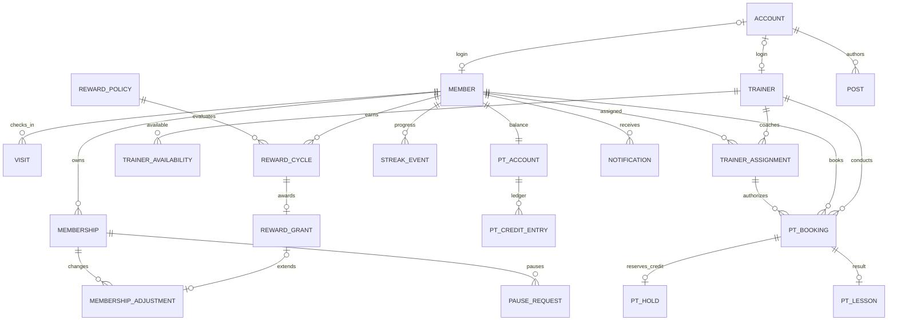

# 헬스장 앱 DB 설계서

버전: 0.1 · 작성일: 2026-10-19 · 상태: 논리 설계 초안

기준 문서: `요구사항정의서.md` v0.11. 확정 요구와 구현을 위한 설계 제안을 구분한다. 특정 DB 제품, 로그인 서비스, 운영 정책을 확정한 문서는 아니다. 결제·운동기록·그룹수업은 이번 설계 범위에서 제외한다.

## 1. 설계 방향

- 단일 헬스장용이다. 회원에게 지점 선택을 요구하지 않는다. `gym_settings`는 단일 설정 행이며 모든 테이블에 지점 ID를 반복하지 않는다.
- 회원·트레이너는 업무상 인물이고 계정은 로그인 수단이다. 트레이너 계정 없이 운영자가 일정을 대신 관리할 수 있다.
- 방문 기록은 출석의 원본이다. 혼잡도는 방문 시각으로 조회 시 계산한다. 2시간 경과를 실제 퇴장으로 기록하지 않는다.
- 회원권 변경과 PT 횟수 변경은 원장에 남긴다. 현재 만료일·잔여 횟수만 덮어쓰는 방식은 사용하지 않는다.
- 동시 예약·중복 스캔·보상 중복 지급은 화면 차단만으로 해결하지 않고 DB 제약과 트랜잭션으로 보장한다.
- 미정 정책은 설정 또는 정책 버전으로 분리한다. 미설정 값을 임의의 기본값으로 적용하지 않는다.

## 2. 공통 표기와 날짜

아래 항목 중 ID는 기본키(PK), `*_id`는 별도 설명이 없으면 외래키(FK)다. 식별자는 UUID 또는 정수 대체키 중 구현 시 선택한다. 표에서 `?`는 NULL 허용을 뜻한다. FK의 실제 NULL 허용 여부는 각 항목을 따른다.

시점은 시간대가 있는 timestamp에 해당하는 타입으로 저장하고, 날짜는 DATE로 저장한다. 표시·영업일 판정 시간대는 `gym_settings.timezone`을 따른다. 한국 시간 적용은 설계 제안이다. 시스템 판정 시각은 서버가 정한다.

시간 구간은 `[시작, 종료)`로 비교한다. 18~19시와 19~20시는 겹치지 않는다. 회원권·휴회는 업무 화면의 종료일 포함 여부를 확정한 뒤 내부 구간으로 변환한다. 이 문서는 만료일 포함 여부를 확정하지 않는다.

일반 업무 테이블에는 `created_at`, `updated_at`을 둔다. 원장·감사 로그는 작성 후 수정·삭제하지 않고 반대 조정으로 정정한다. 상태 값에는 CHECK 또는 상태 코드 FK를 적용하고, 허용 상태 전이는 서버에서 검증한다. 주요 행에는 `version`을 두어 오래된 화면에서 덮어쓰는 것을 방지한다.

## 3. 핵심 ERD

주요 관계만 표현했다. 인증·운영 설정·감사 로그의 보조 관계는 생략한다.

## 4. 테이블 정의

### 4.1 설정·사람·권한

| 테이블 | 주요 필드 | 제약·설명 |
|---|---|---|
| `gym_settings` | id, name, timezone, congestion_capacity?, congestion_thresholds?, stale_after_seconds?, updated_by | 단일 행. 혼잡 기준 미설정은 NULL로 표현. 0명과 집계 실패는 별개 |
| `accounts` | id, auth_subject, display_name, status | auth_subject UNIQUE. 외부 인증 주체 식별자, 인증 방식 미정. 비밀번호·연락처 수집을 전제하지 않음 |
| `account_roles` | account_id, role | 복합 PK. MEMBER / OPERATOR / TRAINER 역할 제안. 실제 관리 권한 세분화는 후속 결정 |
| `members` | id, account_id?, display_name, status, registered_at | account_id UNIQUE. 가입 전 운영자 선등록 가능하도록 계정 연결은 선택 |
| `trainers` | id, account_id?, display_name, status | account_id UNIQUE. 로그인 없는 트레이너 가능 |
| `operating_calendar` | business_date, day_type, opens_at?, closes_at?, reason?, revision, changed_by | business_date PK. OPEN / CLOSED. 미등록일을 자동으로 휴무로 취급하지 않음. 초기에는 날짜별 등록; 주간 규칙 UI에서 일별 행 생성 가능 |
| `business_policy_versions` | id, effective_from, effective_until?, status, policy_values, approved_by?, approved_at? | 초안/승인 구분. 회원권 종료일, 재스캔, 휴회 초기화, PT 확보·차감 등 승인 정책 스냅샷. JSON 사용 시 허용 키·타입 검증. 주요 실행 결과에서 적용 버전 참조 |

회원 상태와 회원권 유효성은 분리한다. 계정 정지, 회원 탈퇴, 회원권 만료가 같은 의미가 아니다. 권한은 현재 계정 상태·역할을 매 요청 확인하며 회원 ID를 입력받았다는 이유만으로 접근을 허용하지 않는다.

### 4.2 QR·기기·방문

| 테이블 | 주요 필드 | 제약·설명 |
|---|---|---|
| `checkin_devices` | id, name, credential_ref, status, revoked_at?, last_seen_at? | credential_ref는 인증 비밀의 안전한 저장 위치 또는 검증용 해시. 출입문 제어 필드 없음 |
| `member_qr_credentials` | id, member_id, token_hash, issued_at, expires_at?, revoked_at? | token_hash UNIQUE. QR 원문·개인정보 저장 금지 제안. 고정/갱신형 결정 후 만료 제약 보완 |
| `checkin_requests` | id, device_id, request_key, payload_fingerprint, received_at, result_code, visit_id?, processed_at? | UNIQUE(device_id, request_key). 동일 키·다른 요청 내용은 거부. 성공·중복·거절 결과를 재전송에 재사용 |
| `visits` | id, member_id, device_id?, checked_in_at, attendance_date, congestion_until, status, source, recorded_by?, correction_reason? | VALID / VOID. QR / MANUAL. congestion_until = checked_in_at + 2시간. attendance_date는 헬스장 시간대의 입장일. 수동 입력은 변경자·사유 필수 |
| `visit_revisions` | id, visit_id, actor_account_id, changed_at, reason, before_values, after_values | 정정 내역 보존. 시각 변경 시 출석일과 집계 종료 예정 시각도 같은 트랜잭션에서 갱신 |

월별 출석용 별도 원본 테이블은 만들지 않는다. `visits`의 유효 기록에서 날짜를 중복 제거해 조회하는 안이다. 같은 날 1일 집계는 정의서의 제안 규칙이며 승인 후 적용한다.

### 4.3 회원권·휴회

| 테이블 | 주요 필드 | 제약·설명 |
|---|---|---|
| `memberships` | id, member_id, starts_on, original_expires_on, current_expires_on, status, version | 날짜 역전 금지. 보유 회원권과 현재 이용 가능 여부 구분. 중복 회원권 제한은 정책 결정 후 적용 |
| `membership_adjustments` | id, membership_id, kind, delta_days, before_expires_on, after_expires_on, pause_request_id?, reward_grant_id?, reversal_of_id?, operation_key, policy_version_id, actor_account_id?, reason, applied_at | operation_key UNIQUE. PAUSE / REWARD / MANUAL / REVERSAL. 회원권 행 잠금 후 원장 추가와 현재 만료일 갱신을 함께 수행 |
| `pause_requests` | id, membership_id, requested_from, requested_until, approved_from?, approved_until?, status, requested_at, decided_by?, decided_at?, decision_reason?, started_at?, ended_at?, policy_version_id? | REQUESTED / APPROVED / REJECTED / CANCELLED / ACTIVE / ENDED 제안. 승인 기간은 요청 기간과 별도 보존 |

휴회 승인과 회원권 연장 적용 시점은 정책에 따라 실행한다. 같은 휴회에 대한 연장 원장은 한 건만 허용하는 UNIQUE 제약을 둔다. 조기 복귀 등 후속 변경은 원장 반대 조정 후 새 조정으로 처리한다. 승인된 휴회 구간 겹침은 같은 회원권 잠금 아래 검사한다.

### 4.4 PT 담당·일정·예약

| 테이블 | 주요 필드 | 제약·설명 |
|---|---|---|
| `trainer_assignments` | id, member_id, trainer_id, effective_from, effective_until?, changed_by, reason | 회원별 적용 구간 겹침 금지. 담당자 변경은 기존 행 종료와 새 행 추가 |
| `trainer_availability` | id, trainer_id, starts_at, ends_at, kind, reason?, created_by | AVAILABLE / BLOCKED. 구체적 날짜·시간 구간. 반복 일정 UI는 기간 내 실제 행 생성 가능 |
| `pt_bookings` | id, member_id, trainer_id, assignment_id, starts_at, ends_at, status, policy_version_id, booked_at, cancelled_at?, cancellation_kind?, cancelled_by?, version | 수업 구간 정확히 1시간. trainer_id는 예약 당시 담당자. assignment_id의 회원·트레이너와 일치하도록 복합 FK 또는 트리거 사용 |
| `pt_booking_events` | id, booking_id, event_type, before_values, after_values, actor_account_id?, reason?, occurred_at | 예약·변경·취소·운영자 예외 이력. 자동 처리도 실행 주체 구분 |
| `pt_lessons` | id, booking_id, outcome, processed_by, processed_at, note? | booking_id UNIQUE. COMPLETED / NO_SHOW 등 수업 결과. 실제 운동시간 측정값을 의미하지 않음 |

예약 담당자 검증은 예약 요청 시점의 유효 배정을 기준으로 제안한다. 미래 배정 예약 허용 여부는 별도 결정한다. 배정이 바뀌어도 기존 예약의 trainer_id는 바꾸지 않는다.

빈 시간은 AVAILABLE 안에 완전히 포함되고 BLOCKED·다른 유효 예약과 겹치지 않는 1시간 구간이다. 정시 시작만 허용한다고 가정하지 않는다. 승인 대기 예약이 시간을 점유할지도 정책으로 결정한다.

### 4.5 PT 횟수 원장과 확보

| 테이블 | 주요 필드 | 제약·설명 |
|---|---|---|
| `pt_accounts` | id, member_id, balance, held_count, version | member_id UNIQUE. 잔액과 확보 횟수의 잠금·조회용 요약. 원장과 대조 가능해야 함 |
| `pt_credit_entries` | id, pt_account_id, booking_id?, kind, delta, balance_before, balance_after, reversal_of_id?, operation_key, actor_account_id?, reason, created_at | operation_key UNIQUE. GRANT / CONSUME / RESTORE / ADJUST. delta는 부호 있는 정수. 잔액 전후 일치 검사 |
| `pt_holds` | id, booking_id, pt_account_id, quantity, status, held_at, resolved_at? | booking_id UNIQUE, quantity=1. HELD / RELEASED / CONSUMED. 예약 확보 정책 채택 시 사용 |

설계 제안은 `예약 가능 횟수 = balance - held_count`다. 확보는 사용 차감이 아니며 예약 때 balance를 줄이지 않는다. 예약 시 확보·수업 완료 또는 늦은 취소/노쇼 때 차감·기한 내 취소 때 해제하는 정책이 승인되면 이 구조를 적용한다. 차감 시 확보 해제와 원장 기록은 한 트랜잭션이다. 예외 면제는 차감 전이면 확보 해제, 차감 후면 복원 원장을 남긴다. 예약 취소 후 늦은 취소 차감이 발생했더라도 취소 상태 자체는 유지한다.

동일 예약의 기본 차감은 부분 UNIQUE 등으로 한 건만 허용한다. 복원은 원래 차감 원장을 참조하고 같은 원장의 중복 복원을 제한한다. 정정 후 재차감이 필요하면 새 조정 이벤트를 명시적으로 생성한다. 음수 잔액·확보 초과는 금지하는 안이며 운영자 조정 예외는 확정 필요하다. PT 상품별 유효기간은 미정이므로 현재는 회원 단위 원장이다. 상품별 만료가 필요해지면 이용권 묶음과 차감 배분을 추가한다.

### 4.6 연속 출석·보상

| 테이블 | 주요 필드 | 제약·설명 |
|---|---|---|
| `reward_policies` | id, version_no, effective_from, effective_until?, required_days, reward_days, status, business_policy_version_id | 버전 UNIQUE. 확정 조건은 10일/1일. 초안과 승인 정책 구분 |
| `reward_cycles` | id, member_id, policy_id, cycle_no, starts_on, completed_on?, status, counted_days, revision | UNIQUE(member_id, policy_id, cycle_no). IN_PROGRESS / QUALIFIED / CLOSED / REVIEW_REQUIRED. 카운트 10 달성 시 다음 주기로 이동; 지급 대기와 진행 카운트는 분리 |
| `streak_events` | id, member_id, cycle_id?, business_date?, event_type, count_before, count_after, visit_id?, pause_request_id?, calendar_revision?, operation_key, policy_version_id, occurred_at | operation_key UNIQUE. ATTEND / ABSENCE_RESET / PAUSE_RESET / COMPLETE / CORRECTION. 인정일은 주기 내 같은 날짜 한 번 |
| `reward_grants` | id, cycle_id, membership_id?, status, granted_days, qualified_at, applied_at?, reviewed_by?, reason? | cycle_id UNIQUE. PENDING / APPLIED / REVIEW_REQUIRED / REVERSED. 적용 시 대상 회원권 필수. 연장 전후 날짜는 연결된 회원권 원장에서 조회 |

휴무일은 카운트를 증가시키거나 끊지 않는다. 결석 확정은 영업일 종료 후 수행하며 운영 달력이 누락되었거나 기기 장애 기록 검증이 필요하면 평가 보류로 처리한다. 순서가 중요한 같은 회원의 출석·휴회·평가·정정은 회원 행 잠금 아래 직렬 처리한다.

평가 근거는 유효 방문·영업일 달력·승인 휴회·적용 정책이다. 정정 시 과거 주기를 삭제해 다시 지급하지 않고 영향받은 주기와 지급 건을 검토 상태로 표시한다. 지급 회수·재지급 정책은 미정이다. 동일 10일 주기를 재평가할 때 기존 cycle_id를 유지해 지급 중복을 방지한다. 일별 인정 이벤트도 회원·정책·날짜 기준 중복 방지 키를 사용한다.

### 4.7 게시물·알림·감사

| 테이블 | 주요 필드 | 제약·설명 |
|---|---|---|
| `posts` | id, type, title, body, status, author_account_id, published_at? | NOTICE / TIP, DRAFT / PUBLISHED / UNPUBLISHED. 일반 회원은 PUBLISHED만 조회 |
| `notifications` | id, member_id, membership_id?, booking_id?, event_type, channel?, scheduled_at?, status, dedupe_key, source_version, sent_at?, attempt_count | dedupe_key UNIQUE. PENDING / SENDING / SENT / FAILED / CANCELLED. 채널·시점 미정이면 발송 대기열로 실행하지 않음 |
| `notification_attempts` | id, notification_id, attempt_no, attempted_at, result, provider_message_id?, error_code? | UNIQUE(notification_id, attempt_no). 오류에 토큰·개인정보 원문을 남기지 않음 |
| `audit_logs` | id, actor_account_id?, actor_type, target_type, target_id, action, reason?, before_values?, after_values?, occurred_at, request_id? | 권한·정책·달력·휴회·게시물 등 변경 감사. 업무 원장을 대체하지 않음. 대상별 FK 보장 불가하므로 주요 원장은 개별 FK 유지 |

알림 생성은 예약·회원권 변경과 같은 트랜잭션에 기록하는 아웃박스 방식으로 제안한다. 발송 작업은 현재 상태·source_version을 다시 검사한다. 이미 발송 서비스에 넘긴 알림은 취소를 보장할 수 없으므로 발송 확정 지점과 변경 처리를 조율한다. 외부 서비스가 멱등 키를 지원하지 않으면 전달 성공 후 응답 유실에 대한 완전한 중복 방지는 불가능하며 대조 절차가 필요하다.

## 5. 동시 처리와 무결성

### QR 출석

1. 등록·활성 기기와 QR 유효성을 검사한다. 해당 기기·요청 키를 등록하고 기존 처리 결과가 있으면 그대로 반환한다.
2. 회원 행을 잠그고 이용 자격을 승인 정책으로 확인한다.
3. `checked_in_at ≤ 현재 시각 < congestion_until`인 유효 방문이 있으면 새 방문을 생성하지 않고 기존 방문을 반환한다. 최초 입장 시각을 갱신하지 않는다.
4. 기존 2시간 구간이 끝났으면 승인된 재스캔 정책을 적용한다. 정책 미정이면 신규 방문 인정을 임의로 결정하지 않는다.
5. 방문과 요청 결과를 함께 커밋한다. 출석 인정·보상 처리는 같은 트랜잭션 또는 멱등 이벤트 처리로 연결한다.

서버 응답 유실 후 재전송은 동일 요청 키를 쓴다. QR이 1회용인 정책에서도 이미 성공한 요청 결과를 안전하게 복구할 수 있도록 인증된 동일 기기의 기존 요청 조회와 QR 신규 사용 판정을 구분한다.

### PT 예약

회원 → 트레이너 → PT 계좌 순서처럼 모든 예약·일정 변경 경로에서 일관된 잠금 순서를 정한다. 같은 트랜잭션에서 담당자, 가능 시간, 겹침, 이용 자격, 확보 가능 횟수를 확인하고 예약·확보를 함께 기록한다.

겹침 조건은 `기존 시작 < 신규 종료 AND 신규 시작 < 기존 종료`다. 단순 `UNIQUE(trainer_id, starts_at)`로는 18:00~19:00과 18:30~19:30 충돌을 막지 못한다. DB가 구간 배제 제약을 지원하면 활성 예약에 적용하고, 지원하지 않으면 트레이너 행 잠금 아래 겹침 조회·삽입을 수행한다. 가능 시간·휴무 변경도 같은 잠금 규약을 따른다. 회원의 겹치는 예약 금지 여부는 미정이며 채택하면 회원 잠금 아래 동일 검사를 추가한다.

회원 취소 기한 내 판정은 `요청 서버 수신 시각 ≤ starts_at - 24시간`이다. 정확히 24시간 전은 기한 내다. 기한 이후에는 일반 취소와 별도의 늦은 취소·운영자 처리 흐름을 사용하며 기본 1회 차감 규칙을 적용한다.

### 보상·휴회 연장

회원권 행을 잠그고 중복 키를 확인한 후 원장 추가와 현재 만료일 변경, 지급/휴회 처리 결과를 함께 커밋한다. 같은 회원권에 휴회 연장과 보상이 동시에 적용되어도 한쪽 변경이 유실되지 않아야 한다. 휴회 승인 반복은 동일 휴회 조정을 다시 만들지 않는다. 만료 회원권 재활성화와 보상 적용 대상은 미정이므로 자동 추정하지 않는다.

## 6. 조회와 인덱스

| 화면·작업 | 조회 기준 | 권장 인덱스 |
|---|---|---|
| 현재 추정 인원 | VALID이며 입장 ≤ 집계 시각 < 집계 종료인 member_id 고유 개수 | visits(status, congestion_until, member_id), 실제 실행계획으로 조정 |
| 월별 출석 | member_id, attendance_date의 월 시작 이상·다음 달 시작 미만, VALID | visits(member_id, attendance_date, status) |
| 내 회원권 | member_id와 시작·만료일, 승인 휴회로 판정 | memberships(member_id, status) |
| 담당자 시간표 | trainer_id와 조회 시간 구간 | pt_bookings(trainer_id, starts_at), trainer_availability(trainer_id, starts_at) |
| 내 PT 이력 | member_id, starts_at 내림차순 | pt_bookings(member_id, starts_at) |
| PT 원장 | pt_account_id, created_at | pt_credit_entries(pt_account_id, created_at) |
| 발송 대상 | PENDING/재시도 가능 상태, scheduled_at ≤ 현재 | notifications(status, scheduled_at) |
| 게시 목록 | type, PUBLISHED, published_at 내림차순 | posts(type, status, published_at) |
| 개근 평가 | member_id, business_date | streak_events(member_id, business_date) |

현재 인원은 증감 카운터만 저장해 운영하지 않는다. 별도 자동 종료 작업이 늦어져도 조회 조건 자체가 2시간 만료를 제외한다. `congestion_until`은 예정 제외 시각이고 실제 퇴장 시각이 아니다. 집계 성공 시각은 응답에 포함하고 실패·지연은 정상 0명과 구분한다.

잔여일은 회원권 날짜·휴회·현재 날짜로 계산하며 매일 감소시키는 저장 컬럼을 두지 않는다. 회원권 상태도 날짜상 만료와 운영자 정지/취소를 구분해 계산한다.

## 7. 요구사항 연결

| 요구사항 | 설계 대상 |
|---|---|
| FR-01~02, FR-11 | accounts, account_roles, members, gym_settings, 서버 접근 제어 |
| FR-03~10, FR-12, FR-24 | devices, QR, requests, visits, visit_revisions, 운영 설정 |
| FR-13~14, FR-26 | memberships, membership_adjustments, pause_requests |
| FR-15~17, FR-27~28 | trainer_assignments, trainer_availability, pt_bookings, events, lessons, PT 원장·확보 |
| FR-18~20 | posts |
| FR-21~23, FR-29 | operating_calendar, reward_policies, reward_cycles, streak_events, reward_grants, 회원권 원장 |
| FR-25 | notifications, notification_attempts |

제안 요구에 대응하는 테이블도 데이터 일관성 확보를 위한 설계 제안으로 포함했다. 이를 근거로 요구사항의 확정 상태를 변경하지 않는다.

## 8. 물리 설계 전 결정할 사항

| 우선순위 | 결정 | 영향 |
|---|---|---|
| 1 | DB 제품·인증 방식 | 실제 DDL, 구간 충돌 제약, 계정 연결 |
| 2 | 회원권 종료일 포함 여부·만료/휴회 중 출석·예약 자격 | 날짜 계산, 예약·출석 검증 |
| 3 | 2시간 이후 재스캔 인정·같은 날 출석 1일 집계 | 방문 생성과 월별 집계 |
| 4 | PT 즉시 확정·확보 시점·차감 시점·변경 기한 | 예약 상태, 활성 구간, PT 원장 |
| 5 | 월 경계 개근 유지·자동 보상·휴회 초기화 시점 | 평가 실행 시점, 정책 설정 |
| 6 | 휴회 연장 일수·조기 복귀·기존 PT 처리 | 조정 원장, 승인 전 검증 |
| 7 | 알림 채널·발송 시점 | 전송 연동, 발송 설정 |

현재 결과는 요구사항 검토용 논리 설계다. 실행 가능한 SQL과 마이그레이션은 DB 제품 및 우선 정책을 정한 다음 작성한다.

## 9. 구현 검증 시나리오

- 같은 요청 재전송과 서로 다른 기기의 동시 스캔에도 유효 2시간 구간에 방문이 추가되지 않는다.
- 10:00 입장은 11:59:59까지 포함, 12:00부터 제외된다. 자정이 지나도 동일하다.
- 월말 방문·정정은 헬스장 시간대의 올바른 날짜와 월에 반영된다.
- 한 트레이너의 18~19시와 18:30~19:30 동시 요청 중 하나만 확정되고 19~20시는 허용된다.
- 시작 정확히 24시간 전 취소는 기한 내, 그 이후는 늦은 취소로 구분한다.
- 잔여 1회로 두 예약을 동시에 요청해도 확보 정책 적용 시 하나만 성공한다.
- 수업 완료·늦은 취소·노쇼의 반복 처리와 운영자 복원 재시도로 중복 차감·복원이 발생하지 않는다.
- 휴무일을 건너뛴 10회 출석은 보상 1회, 20회 출석은 2회이며 지급 지연 중에도 다음 주기를 구분한다.
- 휴회 초기화 시점에 7일 카운트가 0이 되고 복귀 첫 출석은 1일이다.
- 휴회 연장과 보상 동시 적용 시 원장 합계와 현재 만료일이 일치한다.
- 출석·달력 정정 후 지급 완료 보상이 자동으로 중복 지급되지 않고 검토 상태가 된다.
- 예약 취소·만료일 변경 후 이전 버전의 예정 알림이 발송 대상에서 제외된다.
- 회원·기기·운영자 권한을 바꿔 요청해도 허용 범위 밖 개인정보·수정 기능에 접근할 수 없다.
