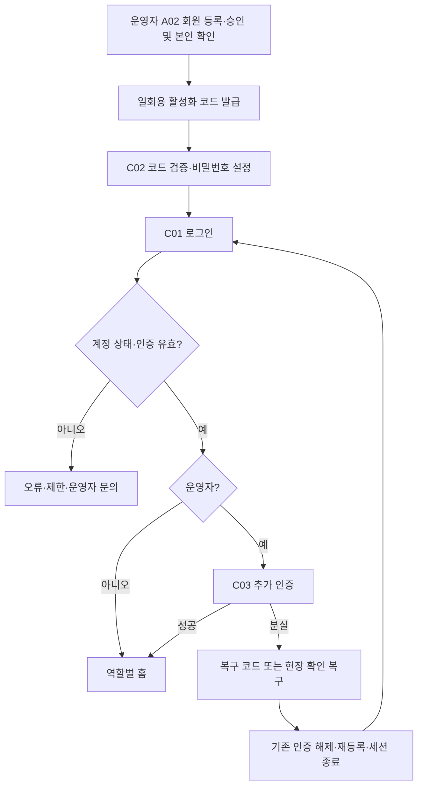
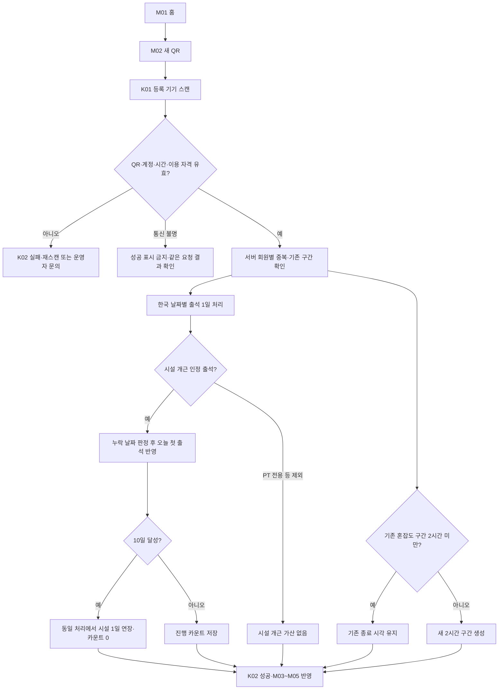
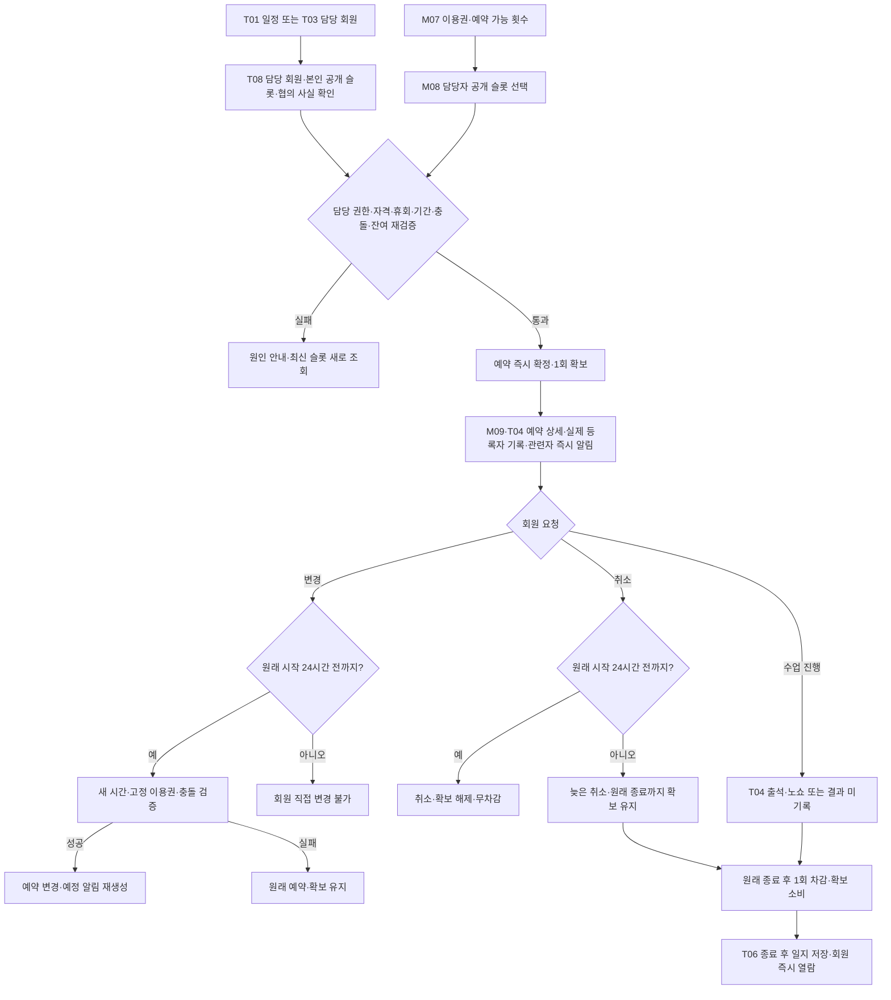
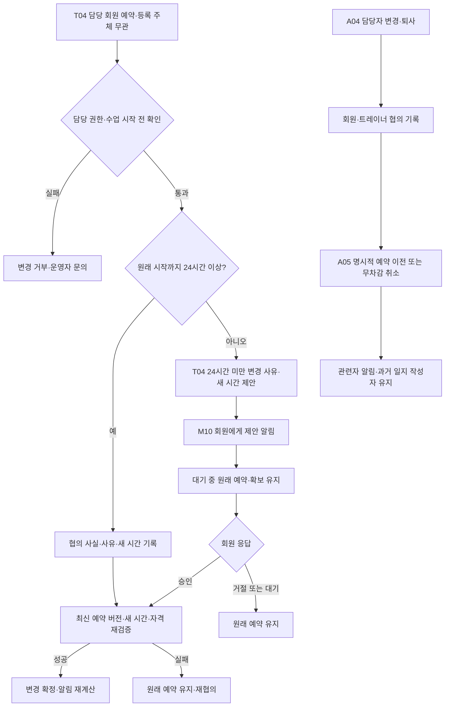
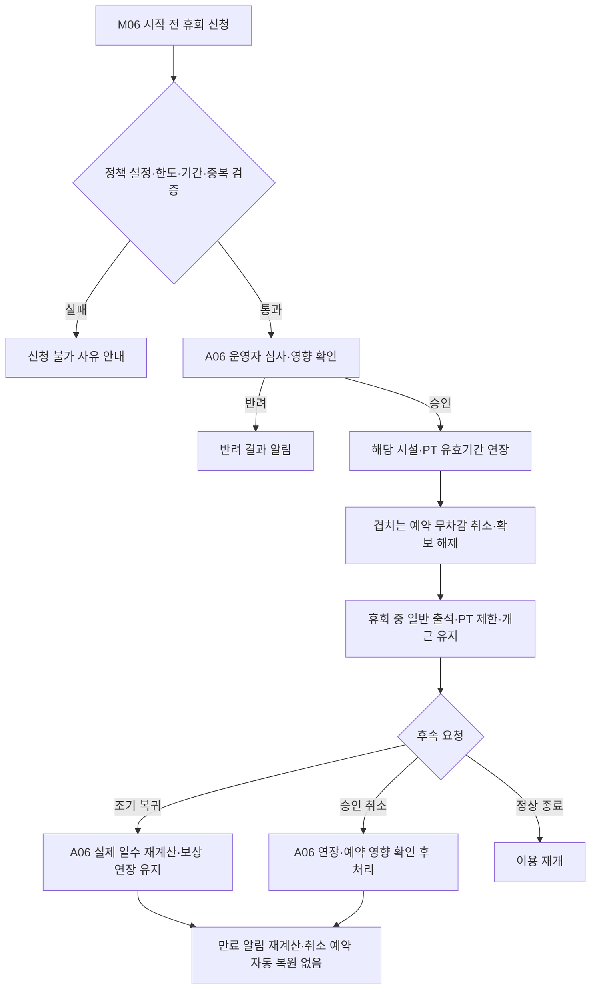
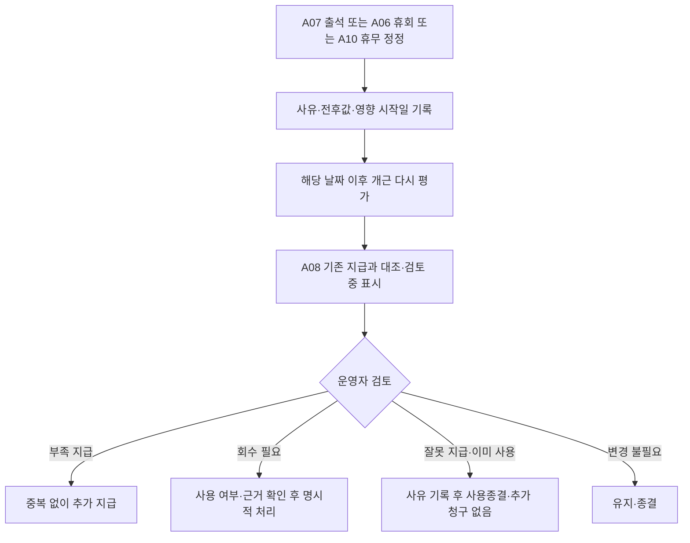

# 헬스장 앱 사용자 흐름도

버전: 0.2 · 2026-10-19 · 설계 초안

근거: 요구사항정의서.md v1.1, DB설계서.md v1.1. 화면 ID는 [화면 목록](화면목록.md), BR ID는 [업무 규칙표](업무규칙표.md)에 연결한다. 흐름의 화면 분할은 제안이며 기존 정책이 우선한다. 아래 자동 작업은 화면이 아닌 서버 처리다.

## 1. 계정 활성화·로그인

BR-01~03. 분실은 운영자 본인 확인 후 재설정 코드 발급→C02, 재발급 시 기존 코드 폐기. 트레이너 추가 인증은 선택이다.

## 2. QR 출석·혼잡도·개근

BR-04~09. 실제 성공은 출석·혼잡도·대상 보상을 함께 확정한 뒤 표시한다. 자정 재스캔의 새 출석일은 기존 혼잡도 종료를 연장하지 않는다. 자정 자동 판정은 휴무·휴회 유지, 일반 영업일 결석 초기화다. 장애 출석은 A07 사유 등록→중복 대조→필요 시 A08 재판정으로 연결한다.

## 3. PT 예약·변경·취소·차감

BR-12~18. 일지는 차감의 선행 조건이 아니다. 정확히 24시간 전은 변경·취소 허용이다. 늦은 취소는 영향 확인 후 처리하며 무차감으로 표시하지 않는다. 운영자 사전 면제는 확보 해제·무차감, 사후 복원은 원 차감을 참조해 1회 복원한다. 트레이너 사정 취소는 즉시 확보 해제·무차감·알림 후 별도 재예약이다.

## 4. 트레이너의 예약 변경·담당 변경

BR-16~18. 정확히 24시간 전은 일반 변경 경로다. 변경 시 기존 예약·고정 이용권과 1회 확보를 유지하며 새 시간의 자격·충돌을 검증한다. 거절 UI는 설계 제안이다. 제안은 새 시간을 점유하지 않는다. 시작 후 과거 일정 이동은 운영자 정정만 가능하다. 새 담당자는 과거 일지를 읽고 원 작성자 수정 권한을 승계하지 않는다.

## 5. 휴회 신청·승인·취소·조기 복귀

BR-10~11. 승인 전 신청은 시작 전 회원 취소 가능. 소급 휴회는 운영자만 처리하고 이미 발생한 수업·차감·보상을 대조한다. 만료 PT를 임의 재활성화하지 않는다.

## 6. 과거 정정·재판정

BR-09. 자동 회수하지 않으며 검토 제안을 확정 보상으로 표시하지 않는다.

## 7. 일지·게시물·탈퇴

- T06 종료 수업 선택→일반 텍스트 검증→저장 즉시 M11 공개→원 작성자 또는 운영자 수정·이력. 새 담당자는 읽기만 가능. 민감정보 신고→A13 접근 제한→본문·이력 정정/파기→최소 처리 사실 기록(BR-18).
- A09 초안·편집→파일·링크 검증→게시→C07 목록·직접 접근 허용. 게시 해제→일반 사용자 직접 접근 차단. 자동 공지 푸시 없음(BR-19).
- C05→C06 재인증·정산 별도 안내→탈퇴 접수→세션·QR·푸시 즉시 회수→서비스 파기 작업·필요 최소 분리보존→백업 삭제 대조→A13 완료/지연 관리. 접수 성공과 파기 완료를 구분한다(BR-21).

## 8. 공통 실패 복구

권한·자격은 화면 진입과 쓰기 처리 때 서버에서 확인한다. 중복 클릭·응답 유실은 같은 요청 결과를 대조한다. 충돌·오래된 버전이면 최신 상태를 표시하고 변경 실패로 기존 예약을 잃지 않는다. 알림 실패는 확정된 예약·출석을 되돌리지 않으며 알림함과 푸시 전송 상태를 구분한다(BR-20·22).

