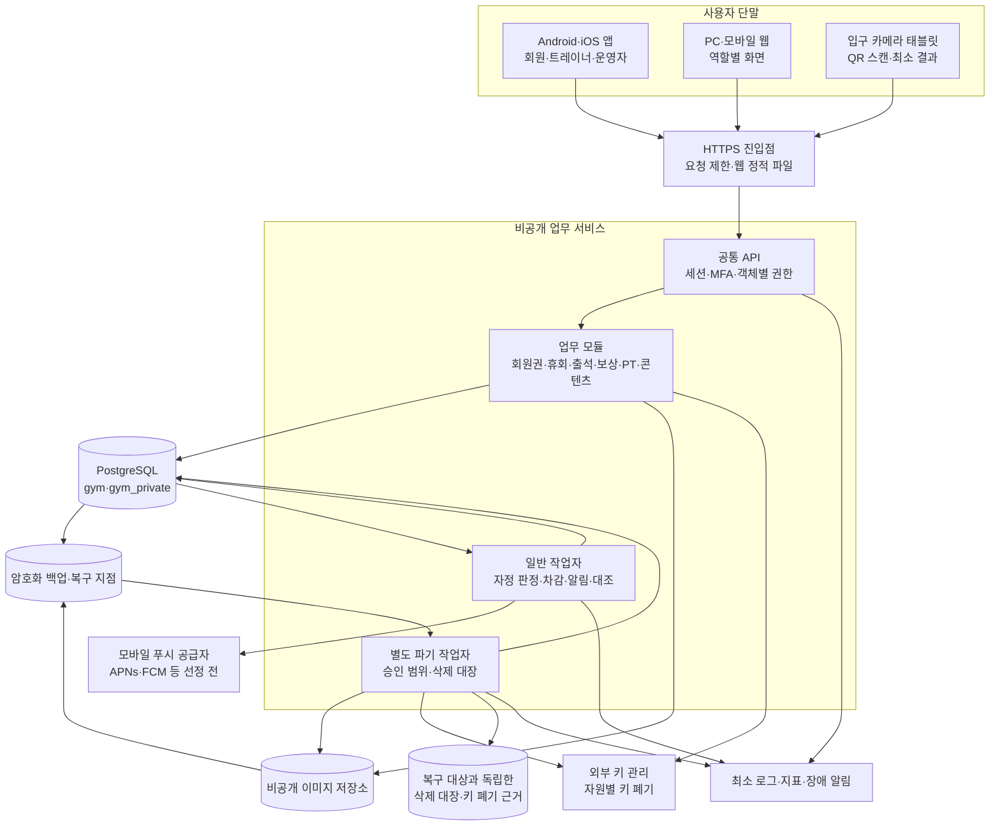
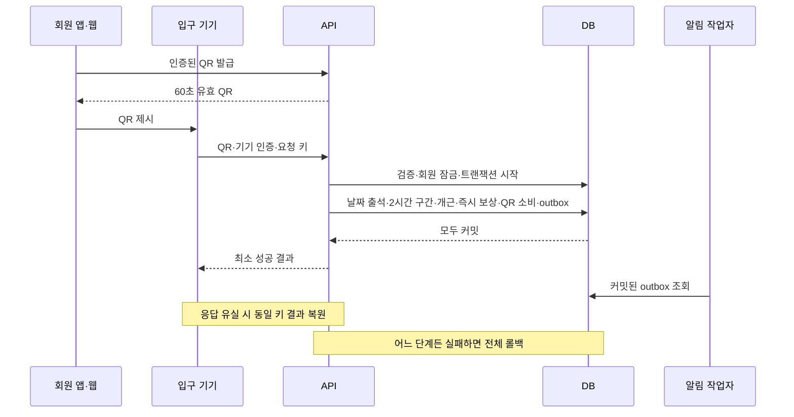

# 헬스장 앱 시스템 구성도

버전: 0.1 · 2026-10-19 · 구현 전 구성 제안

근거: [요구사항](요구사항정의서.md) v1.1·[DB 설계](DB설계서.md) v1.1. 정책은 기존 문서를 따른다. 실제 서버·클라우드·푸시·KMS·기기는 아직 구성하지 않았다. 특정 업체·비용·성능 달성을 확정한 문서가 아니다.

## 1. 논리 구성

화살표는 데이터 흐름·처리 의존 관계이며 모든 연결의 네트워크 개방을 뜻하지 않는다. DB·키·원본 객체·백업은 인터넷에 직접 노출하지 않는다. 카메라 영상은 단말에서 QR 해독에만 쓰고 서버에 저장하지 않는다. 입구 단말은 출입문을 제어하지 않는다.

## 2. 개발·배포 단위

초기는 업무 모듈을 한 서버 코드베이스에 두고 API·일반 작업자·파기 작업자를 별도 프로세스/자격증명으로 실행하는 구성을 제안한다. 단일 헬스장 규모에서 분산 트랜잭션을 늘리지 않고 출석+즉시 보상·예약+확보를 DB 한 트랜잭션으로 확정하기 위한 선택이다.

| 구성 | 책임 | 장애·권한 경계 |
|---|---|---|
| 앱·반응형 웹 | 동일 API·역할별 UI·QR 갱신·알림함 | 서버 확정 전 성공 표시 금지; 푸시 OFF도 알림함 유지 |
| 입구 웹 | 카메라 인식·등록 기기 인증·같은 키 재조회 | 오프라인 성공·연락처/회원권 표시 금지; 결과5초 제거 |
| API | 세션·MFA·CSRF·멱등키·버전·업무 트랜잭션 | 매 요청 객체 권한; 업무 DB 최소권한·파기 역할 없음 |
| 일반 작업자 | due 작업·outbox·정기 대조 | lease·SKIP LOCKED·고유키·재실행; 파기 권한 없음 |
| 파기 작업자 | 승인된 범위만 삭제·키 폐기·분리보존·복구 대조 | 별도 역할·최소 권한·실행 감사; 일반 API에서 임의 SQL 금지 |
| PostgreSQL | 기간/구간 배제·FK·원장·요약·작업 상태 | 단말 직접 접근 금지; 현 SQL은 RLS 미구성 |
| 객체 저장소 | 검증된 게시물 이미지·격리 업로드 | 비공개 원본; API 권한 검증 경유·게시해제 즉시 차단 |
| 키 관리 | 키와 DB 분리·접근통제·폐기 | 실제 키를 동일 데이터 백업에 저장하지 않음 |
| 관측 | 지연·실패·오류율·작업 누락·최소 감사 | QR/암호/일지/푸시토큰 원문 제외 |

앱 기술·웹 프레임워크·호스팅·리전·관리형 DB·푸시 업체는 미선정이다. 현재 DB 기준은 PostgreSQL15 이상이며 개발 시 지원 버전·확장 설치를 확인한다. 별도 메시지 브로커·Redis는 초기 필수로 두지 않고 DB outbox/세션/작업 lease를 사용한다. 이 선택은 구현 제안이다.

## 3. 주요 처리 흐름

PT 예약도 담당·자격·휴회·충돌을 검사하고 회원→트레이너→이용권 순으로 잠근다. 예약·1회 확보·이벤트·outbox가 한 번에 커밋된다. 일정 변경 실패는 전체 롤백하며 원래 예약·확보를 유지한다. 알림 전송 실패는 이미 확정된 예약을 되돌리지 않는다. 외부 푸시는 정확히 한 번 도달을 보장하지 않으며 중복키·공급자 대조로 중복을 줄인다.

## 4. 자동 작업과 복구

| 작업 | 주기·시각 | 실패 복구·검증 |
|---|---|---|
| 혼잡도 | 화면1분 조회; 유효구간으로 계산 | 성공시각+180초 이상 정보지연; 실패/미설정 구분 |
| 개근 일별 판정 | KST00시 전날 확정 | 날짜별 실행키·누락일 순차 대조; 휴무·휴회 유지 |
| 즉시 보상 | 인정 출석10번째의 동기 처리 | 출석과 같은 커밋; 별도 지연 지급 작업으로 대체 금지 |
| PT 차감 | 1분마다, 예정종료 경과 | 예약당1회 원장·확보 소비·재실행; 미기록 일지 무관 |
| 예정 알림 | 도래시각; 작업자는1분 이내 폴링 제안 | 최신 소스 version 재검증·지난예정 소급 금지 |
| 즉시 알림 | 커밋 outbox, 최대5초 폴링 목표 제안 | 알림함 한 번 생성·푸시 별도; 실제 지연 측정 필요 |
| 푸시 재시도 | 원래 예정+1/+5/+15분 | 30분·수업 시작·상태변경 중 가장 빠른 때 중단 |
| 잔액·원장·확보 대조 | 매시간 및 장애복구 후 제안 | 불일치 자동 덮어쓰기 금지·운영자 검토 |
| 파기·기한 점검 | 요청 즉시 차단; 후속1분 폴링 제안 | 원본·이력·객체·백업별 증거, 지연 담당/종료조건 |
| 백업 | 일일 전체+최대1시간 복구지점·7일 순환 | 선택적 파기 구조 필수·분기별 복구 시험 |

KST 달력 시각과 UTC 실행시각을 구분한다. 프로세스 재시작·중복 실행·lease 만료를 가정하며 작업 완료는 결과 대조 후 기록한다. API 서버와 작업자는 같은 잠금 순서·고유 제약을 사용한다.

## 5. 환경과 보안 경계

개발·검증·운영은 DB/저장소/키/푸시 자격증명을 분리한다. 검증에는 합성 회원·가상 시계·푸시 시험 대상을 사용한다. 신규 SQL을 기존 운영 DB에 덮어쓰지 않으며 데이터 이전은 별도 마이그레이션·백업·복원 시험이 필요하다.

업무 API 계정은 DB 소유자·gym_purger 권한을 갖지 않는다. 배포 때 실제 최소권한·비로그인 그룹·전용 작업 계정을 구성한다. MFA·키 접근·권한 변경·파기 실행의 감사 기록을 남기되 민감 원문은 남기지 않는다. 보존기간과 법적 적용은 요구사항 §10·12 기준이며 이 구성도는 새 법률 판단을 하지 않는다.

## 6. 복구·출시 확인

1. 장애 범위를 차단하고 검증 환경에 백업·복구지점을 복원한다.
2. 복원본과 독립한 삭제 대장·키 폐기 근거를 적용해 삭제 대상을 다시 노출하지 않는다. 본문 외 출석·예약 메타데이터도 포함한다.
3. 예약·확보·원장·보상·회원권·누락 작업·예정 알림을 대조한다. 소급 알림·중복 차감/보상을 차단한다.
4. 역할·키·단말 회수 상태를 확인한 뒤 서비스 공개한다. 복구 시점·유실 범위·복구 소요를 기록한다.

목표는 RPO1시간·RTO4시간, 가정 부하 회원3,000명·동시100명·주요 쓰기10건/초·주요 API p95서버응답2초 이내다. 모두 요구사항의 목표/가정이며 측정 결과가 아니다. 실제 부하·현장 QR 인식·앱 배포/푸시·선택적 백업 파기를 검증하기 전 출시 완료로 표시하지 않는다.
